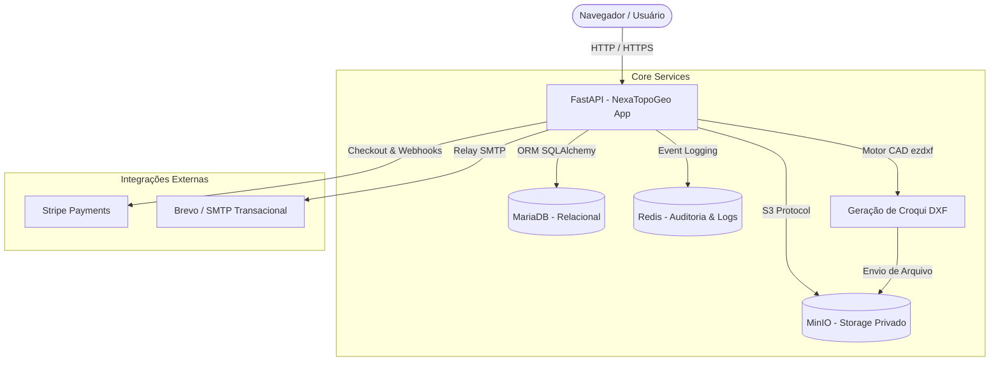

# NexaTopoGeo - Automação B2B para Topografia

> **Projeto desenvolvido com a mentoria do professor [github.com/siriani](https://github.com/siriani)**

---

## 📌 1. Descrição do Negócio (Proposta de Valor)

O **NexaTopoGeo** é uma plataforma SaaS B2B desenvolvida especificamente para escritórios de topografia, agrimensura e engenharia civil. 

### A Dor do Mercado
Escritórios de agrimensura perdem dezenas de horas mensais executando tarefas operacionais manuais e repetitivas:
- Digitação manual de coordenadas extraídas de receptores GNSS/SIGEF para redação de memoriais descritivos no Word.
- Desenho do zero de polígonos e identificação de vértices no AutoCAD.
- Descentralização e perda de arquivos técnicos pesados (DWG, DXF, RINEX, relatórios) espalhados em pen-drives e pastas locais sem backup.
- Risco elevado de inconsistências matemáticas e devoluções burocráticas de processos em Cartórios de Registro de Imóveis (CRI).

### Nossa Solução
O NexaTopoGeo centraliza a gestão técnica e documental em nuvem:
1. **Importação Automatizada:** Carregamento de planilhas de coordenadas georreferenciadas (SIGEF / CSV).
2. **Motor CAD Nativo:** Plotagem e geração instantânea de arquivos de croqui no formato **DXF** prontos para AutoCAD e QGIS sem necessidade de digitação ou desenho inicial manual.
3. **Storage de Engenharia:** Armazenamento seguro de peças técnicas pesadas e fotos de marcos geodésicos em nuvem privada compatível com S3 (MinIO).
4. **Fluxo Kanban:** Acompanhamento visual da tramitação dos projetos desde a medição até o registro cartorial.

---

## 🌐 2. URL do Sistema em Produção

O sistema encontra-se implantado e acessível publicamente através do link:

🔗 **Produção:** `[https://marcio-silva-isw055.lapps.studio/]`

---

## 🏗️ 3. Arquitetura e Infraestrutura

A plataforma foi concebida sob uma arquitetura de serviços conteinerizados via Docker, garantindo alta escalabilidade, isolamento de dados e portabilidade:

- **Backend:** FastAPI (Python 3.11), com endpoints assíncronos de alta performance, injeção de dependências e documentação OpenAPI nativa.
- **Banco de Dados Relacional:** MariaDB, com mapeamento objeto-relacional (ORM) via SQLAlchemy e suporte a transações ACID.
- **Armazenamento de Objetos (Storage):** MinIO (S3 API compatível) para armazenamento de arquivos técnicos binários pesados (DWG, DXF, CSV, PDF).
- **Trilha de Auditoria e Cache:** Redis Streams para registro em tempo real de logs de segurança e eventos críticos (Segregation of Duties).
- **Frontend (SSR):** Jinja2 com HTML5, CSS3 moderno (design system corporativo em paleta Verde Musgo e Off-White) e JavaScript puro para gerenciamento de modais e notificações reativas.
- **Gateways e Mensageria:** Integração com o Stripe API para faturamento recorrente via webhooks assinados criptograficamente.

### Multi-Tenancy e Isolamento de Dados
O sistema implementa o modelo de isolamento lógico de dados (*Multi-Tenancy* por `usuario_id`), garantindo que cada técnico ou escritório de engenharia visualize e gerencie estritamente os seus próprios projetos, clientes e peças técnicas, impossibilitando vazamento ou acesso cruzado entre diferentes contas.

### Fluxo de Comunicação entre Serviços



---

## ⚙️ 4. Funcionalidades Principais (CRUD e Negócio)

1. **Gestão de Projetos em Kanban:**
   - Visualização das ordens de serviço distribuídas em 5 colunas de status: `Orçamento`, `Campo`, `Desenho`, `Cartório` e `Concluído`.
   - Criação ágil de novos projetos através de modal dinâmico no dashboard.
2. **Gestão de Clientes e Contratantes:**
   - Cadastro e relacionamento de proprietários rurais e empresas contratantes vinculado às peças técnicas.
3. **Upload e Validação Especializada de Documentos:**
   - Validação estrita de extensões permitidas para engenharia: `.csv`, `.xlsx`, `.dwg`, `.dxf` e `.pdf`.
   - Identificação automática do tipo de peça técnica (`sigef_csv`, `croqui_dxf`, `memorial_pdf`).
   - Geração de identificadores únicos no storage MinIO com histórico e rastreio.
4. **Motor CAD Automatizado (`dxf_service.py`):**
   - Construção vetorial de polígonos fechados (`LWPOLYLINE`) conectando as coordenadas informadas.
   - Inserção de textos identificadores dos vértices (ex: P01, P02, M-01) com posicionamento relativo e estilização de camadas (layers `POLIGONO` e `VERTICES_TEXTO`).
   - Saída compatível com o padrão AutoCAD 2010 (R2010) para leitura imediata em softwares CAD e SIG.
5. **Monetização e Travas do Plano Freemium:**
   - **Plano Free:** Limite máximo de até 2 projetos por usuário.
   - **Trava no Backend:** Tentativas de criar o 3º projeto no plano Free são interceptadas com status 303 e redirecionadas para a tela de upgrade com alerta visual.
   - **Plano Pro (R$ 149,90/mês):** Projetos ilimitados, geração contínua de croquis DXF e storage dedicado em nuvem.
   - **Automação via Webhooks Stripe:**
     - `checkout.session.completed`: Liberação instantânea do plano Pro.
     - `customer.subscription.deleted`: Revogação imediata para o plano Free em caso de cancelamento.
     - `invoice.payment_failed`: Rebaixamento automático em caso de inadimplência.
6. **Painel Gerencial e Auditoria (Admin):**
   - Monitoramento de KPIs de negócio: total de usuários Free, total de assinantes Pro e cálculo do **MRR (Receita Recorrente Mensal)**.
   - Tabela de trilha de auditoria dos eventos e tentativas de violação de acesso (status 403) registradas no Redis.

---

## 🛡️ 5. Papéis e Segurança (RBAC)

O controle de acesso baseado em papéis (Role-Based Access Control) assegura que nenhuma operação não autorizada ocorra na API:

| Papel | Permissões |
| :--- | :--- |
| `admin` (Engenheiro RT) | Acesso total à plataforma, painel executivo de auditoria, métricas de faturamento (MRR) e supervisão técnica geral. |
| `tecnico` | Criação e condução de projetos, cadastro de clientes, execução de uploads de arquivos técnicos e acionamento da geração de croquis DXF. |
| `usuario` | Operador do escritório com permissões para gestão de seus próprios projetos e atualização cadastral do perfil. |

- **Enforcement Centralizado:** A validação de identidade e privilégios é executada diretamente nas rotas e decoradores do backend, impedindo que requisições adulteradas via API burlem as diretrizes de negócio.

---

## 🚀 6. Instruções de Instalação e Execução

### Pré-requisitos
- [Docker](https://docs.docker.com/get-docker/) e [Docker Compose](https://docs.docker.com/compose/) instalados na máquina host.

### 1. Clonar o Repositório e Configurar o Ambiente
```bash
git clone https://github.com/SEU_USUARIO/TomFlix_App.git
cd TomFlix_App/NexaTopoGeo
```

Crie o arquivo `.env` na raiz do diretório `NexaTopoGeo/` com as variáveis necessárias:
```ini
DB_HOST=db
DB_USER=root
DB_PASSWORD=SuaSenha
DB_NAME=name_db
SECRET_KEY=SuaChaveSecretaJWT_Ou_Sessao

MINIO_ENDPOINT=minio:9000
MINIO_ACCESS_KEY=admin_
MINIO_SECRET_KEY=SuaSenha
MINIO_BUCKET_NAME=documentos-nexatopo

STRIPE_PUBLIC_KEY=pk_test_...
STRIPE_SECRET_KEY=sk_test_...
STRIPE_PRICE_ID=price_...
STRIPE_WEBHOOK_SECRET=whsec_...
```

### 2. Subir os Contêineres via Docker Compose
Execute o build e a inicialização de todos os serviços orquestrados:
```bash
docker-compose up -d --build
```

Os seguintes serviços estarão disponíveis:
- **Aplicação Web (FastAPI):** `http://localhost:8221`
- **Banco de Dados (MariaDB):** porta interna `3306`
- **Object Storage (MinIO):** porta interna `9000` (Console na porta `9001`)
- **Redis & Log Service:** portas internas `6379` e `4000`
- **Microsserviço de Autenticação:** porta interna `3000`

### 3. Modelos e Migração do Banco de Dados
A camada de dados do projeto utiliza modelos declarativos SQLAlchemy centralizados no arquivo:
- 📄 `NexaTopoGeo/models.py`

Ao inicializar o contêiner ou executar o script de inicialização do FastAPI, o mapeamento garante a estrutura das tabelas:
- `usuarios`: Credenciais, papel RBAC, foto e status de assinatura Stripe.
- `clientes`: Dados cadastrais e CPF/CNPJ de proprietários rurais e empresas.
- `projetos`: Título, etapa do fluxo Kanban, área em hectares e relacionamentos.
- `documentos`: Metadados dos arquivos georreferenciados (DWG, DXF, CSV, PDF) persistidos no MinIO.

Para criar as tabelas manualmente via terminal Python dentro do ambiente virtual:
```bash
python -c "from database import engine, Base; from models import *; Base.metadata.create_all(bind=engine)"
```
---

## 📄 7. Documentação e Relatório Técnico

O relatório completo detalhando a arquitetura, desafios e implementação desta atividade encontra-se disponível no diretório de documentação:

* 📄 **[Relatório P2 - Consolidado de Arquitetura e Atividades (PDF)](docs/P2_ISW055_Marcio_Silva.pdf)**

---

## 👨‍💻 Autor e Mentoria

Projeto concebido e desenvolvido no âmbito do curso de Tecnologia de Sistemas Inteligentes / FATEC - Pompéia.

- **Desenvolvedor:** Marcio Hernani
- **Mentoria e Orientação:** Prof. [github.com/siriani](https://github.com/siriani)
